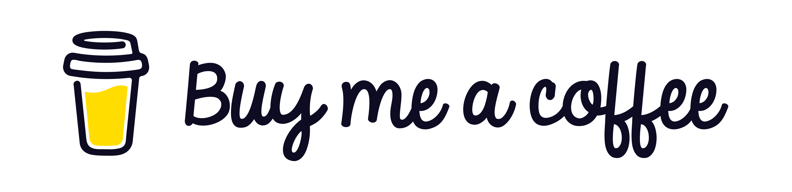

# 👋 Welcome!

&nbsp;&nbsp;I'm a passionate web developer dedicated to crafting **beautiful, responsive, and user-friendly web applications** that inspire and engage. My journey in the tech landscape began when I built my first website. That experience sparked my **joyful passion** for diving deep into user needs and turning those insights into exciting and impactful **digital solutions** that truly enhance their experiences.

&nbsp;&nbsp;What sets me apart is my commitment to creating technology that empowers individuals and communities. I believe that every line of code can make a difference! When I'm not coding, you can find me exploring the latest tech trends or enjoying outdoor adventures, where I can find inspiration for my next project.

- [👋 Welcome!](#-welcome)
  - [📈 GitHub Stats](#-github-stats)
  - [:man\_technologist: Personal Website](#man_technologist-personal-website)
  - [💡 About Me](#-about-me)
  - [🛠️ Languages, Technologies \& Tools](#️-languages-technologies--tools)
  - [✨ Featured Projects](#-featured-projects)
    - [💰 Cryptocurrency Tracker](#-cryptocurrency-tracker)
    - [🚚 Move It](#-move-it)
    - [🌊 Ocean-Minded](#-ocean-minded)
  - [☕ Support My Work](#-support-my-work)
  - [🎉 Fun Facts](#-fun-facts)
  - [💬 Contact Me](#-contact-me)

## 📈 GitHub Stats

## :man_technologist: Personal Website

**https://primesolar.github.io/web-developer/**

## 💡 About Me

- 🌍 Based in Europe.
- 💻 Proficient in: HTML5, CSS3, JavaScript, jQuery ([the most popular JavaScript library in the world](https://w3techs.com/technologies/overview/javascript_library), used by Microsoft, Yahoo, Spotify, Samsung and many others), Node.js, Express, EJS, Tailwind CSS, Bootstrap (used by Cloudflare, Spotify, Samsung, BBC and many others), Twig, SQL, and more!
- 🎓 Engineer Degree from Technological University.
- 📚 Ask me about web development, modern tools, and tech trends!

## 🛠️ Languages, Technologies & Tools

- **Languages:**
  - English, French, Croatian.
- **Front-End:**
  - JavaScript, jQuery, HTML5, CSS3, SASS, Bootstrap, Tailwind CSS.
- **Back-End:**
  - Node.js, Express, EJS, Twig, SQL, PostgreSQL.
- **DevOps:**
  - Git, CI/CD, Jenkins, Docker.
- **Design:**
  - Figma, Lucidchart, Visio, draw.io, AutoCAD.
- **Additional Skills**:
  - Markdown, Swagger, JSON, XML, REST API.
  - Layout Techniques: Grid, Flexbox, Responsive Design.
  - Development Practices: Cross-Browser Development, Pixel Perfect.
  - Programming Concepts: OOP (Object-Oriented Programming), FP (Functional Programming).
  - Tools: Visual Studio Code, Oxygen XML Editor.
  - Modeling: BPMN (Business Process Model and Notation), DFD (Data Flow Diagram).

## ✨ Featured Projects

### [💰 Cryptocurrency Tracker](https://github.com/PrimeSolar/cryptocurrency-tracker)

<!--prettier-ignore-->

<em>The Cryptocurrency Tracker Interface</em>

- **Description:** my web application designed to provide users with real-time tracking of cryptocurrency prices, making it an essential tool for investors, traders, and enthusiasts.
- **Technologies Used:**
  - **JavaScript**: a programming language for dynamic content updates and user interactions, providing a smooth and interactive experience.
  - **APIs**: the web application utilizes the CoinGecko API for fetching real-time cryptocurrency data, ensuring accurate and up-to-date information. Also, it integrates CoinTelegraph's RSS feed to provide the latest cryptocurrency news.
  - **HTML5**: a markup language for structuring the web application, ensuring semantic markup and improved SEO.
  - **CSS3**: a style sheet language for styling and layout, including responsive design techniques that enhance user experience across devices.
  - **Tailwind CSS**: a framework used for consistent UI construction. It provides a collection of CSS utility classes, supports responsive design, and is highly configurable.
- [**Live Demo**](https://primesolar.github.io/cryptocurrency-tracker/)

### [🚚 Move It](https://github.com/PrimeSolar/move-it)

<!--prettier-ignore-->

<em>The Move It Interface</em>

- **Description:** my web application designed to revolutionize the moving experience! The goal is to provide exceptional moving services through a user-friendly website that simplifies the entire process. Explore the platform today to discover how it can help with all moving needs.
- **Technologies Used:**
  - **JavaScript**: a programming language for dynamic content updates and user interactions, providing a smooth and interactive experience.
  - **HTML5**: a markup language for structuring the web application, ensuring semantic markup and improved SEO.
  - **CSS3**: a style sheet language for styling and layout, including responsive design techniques that enhance user experience across devices.
  - **Bootstrap**: a powerful frontend framework for efficient development and responsive design, offering a robust grid system and pre-designed components that streamline the creation of visually appealing and mobile-friendly interfaces, ensuring that the application is user-friendly across devices.
- [**Live Demo**](https://primesolar.github.io/move-it/).

### [🌊 Ocean-Minded](https://github.com/PrimeSolar/ocean-minded)

<!--prettier-ignore-->

<em>The Ocean-Minded Interface</em>

- **Description:** my web application designed for a travel company that specializes in creating wonderful experiences that connect clients with the beauty of the ocean world.
- **Technologies Used:**
  - **Node.js**: a JavaScript runtime built on Chrome's V8 engine that allows me to execute JavaScript on the server side. It enables the development of scalable and high-performance applications, leveraging non-blocking I/O and an event-driven architecture to handle multiple connections simultaneously.
  - **Express.js**: a Node.js web application framework that provides a robust set of features for building web and mobile applications. It simplifies the development process by offering a variety of middleware to handle requests, responses, and routing efficiently.
  - **EJS**: a templating engine that allows me to generate HTML markup with plain JavaScript. It enables dynamic content rendering on the server side, making it easy to create reusable templates and maintain a clean separation between my application logic and presentation.
  - **JavaScript**: a programming language for dynamic content updates and user interactions, providing a smooth and interactive experience.
  - **jQuery**: a fast and lightweight JavaScript library that simplifies HTML document traversing and event handling. jQuery allows for easy manipulation of the Document Object Model (DOM). It also provides methods for handling events, making it straightforward to create the responsive user interface that can react to actions.
  - **Twig**: a modern template engine for PHP that can be utilized in Node.js environments as an npm library. In this application, Twig is used to render templates dynamically, enhancing the code by providing a clean separation between presentation and logic. It integrates seamlessly with Express, allowing the application to leverage templating capabilities while managing routing and API calls effectively.
  - **APIs**: the web application effectively and extensively utilizes well-structured APIs through its Express routes and middleware, allowing for dynamic content rendering, smooth user interaction, and content management. Each route defined in the application serves as a unique API endpoint, responding to specific requests from clients. The API's responsiveness to user actions enhances engagement.
  - **HTML5**: a markup language for structuring the web application, ensuring semantic markup and improved SEO.
  - **CSS3**: a style sheet language for styling and layout, including responsive design techniques that enhance user experience across devices.
  - **Bootstrap**: a powerful frontend framework for efficient development and responsive design, offering a robust grid system and pre-designed components that streamline the creation of visually appealing and mobile-friendly interfaces, ensuring that the application is user-friendly across devices.
- [**Live Demo**](https://ocean-minded.onrender.com/)

## ☕ Support My Work

&nbsp;&nbsp;If you enjoy my projects and would like to support my work, consider buying me a coffee! Your contributions help me stay energized and motivated to create even more amazing content.

&nbsp;&nbsp;Every cup of coffee you buy not only fuels my passion but also allows me to dedicate more time to developing innovative projects and sharing knowledge. Whether it's a small gesture or a generous contribution, every bit is greatly appreciated!

**Click the image to support my work:**

&nbsp;&nbsp;Also, here are a few other ways you can help:

- **Share My Projects**: if you find my work valuable, please share it with your friends, family, or on social media.
- **Provide Feedback**: I welcome your thoughts and suggestions! Your feedback can help me improve my projects and create even better solutions.
- **Follow Me**: stay updated on my latest projects and tech insights by following me on GitHub and LinkedIn. Your support encourages me to keep creating!
- **Engage with My Content**: like, comment and engage with my posts. Your interactions help boost visibility and foster a vibrant community around my work.

&nbsp;&nbsp;Thank you for your support! Together, we can create something wonderful! 💖

## 🎉 Fun Facts

- **Adventurer**: I love exploring the great outdoors! Whether it's hiking in the mountains or kayaking on a serene lake, being in nature recharges my creativity and reminds me how vast the world is.
- **Tech Expert**: I'm always on the lookout for the latest tech trends. I enjoy attending tech meetups and conferences to connect with like-minded individuals.
- **Coffee Admirer**: I have a passion for coffee! A good cup of coffee fuels my creativity. There’s something special about brewing that perfect cup before a coding session.
- **Travel Enthusiast**: I love traveling and experiencing new cultures. Each trip broadens my perspective and sparks fresh ideas I bring back to my development work.
- **Book Lover**: when I'm not coding, you can find me with my nose in a good book. I enjoy reading varied literature, especially anything related to technology and personal development. Reading reminds me that there’s always more to learn and grow.
- **Music Explorer**: my taste spans genres from jazz to synthwave. Discovering new artists inspires me to think outside the box.

**Copyright Notice**

Copyright © Vladislav Kazantsev
All rights reserved.
This repository contains the intellectual property of Vladislav Kazantsev.
You are welcome to clone this repository and use the files for exploratory purposes.
However, unauthorized reproduction, modification, or redistribution of these files (including cloning of this repository or altering it for activities beyond exploratory use) is strictly prohibited.
Files may be shared only when the original author is explicitly credited and a direct link to the original source of a file is provided alongside it.
Sharing links to the repository or its files is permitted, except when directed toward retrieval purposes.
Any form of interaction with this repository or its files is strictly prohibited when facilitated by the code, except when such interaction is for discussion or exchange purposes with others.
This copyright notice applies globally.
Email address for inquiries about collaboration, usage outside exploratory purposes, or permissions: [hypervisor7@pm.me](mailto:hypervisor7@pm.me)

## 💬 Contact Me

&nbsp;&nbsp;LinkedIn [@PepsiCo](https://www.linkedin.com/in/PepsiCo/)

